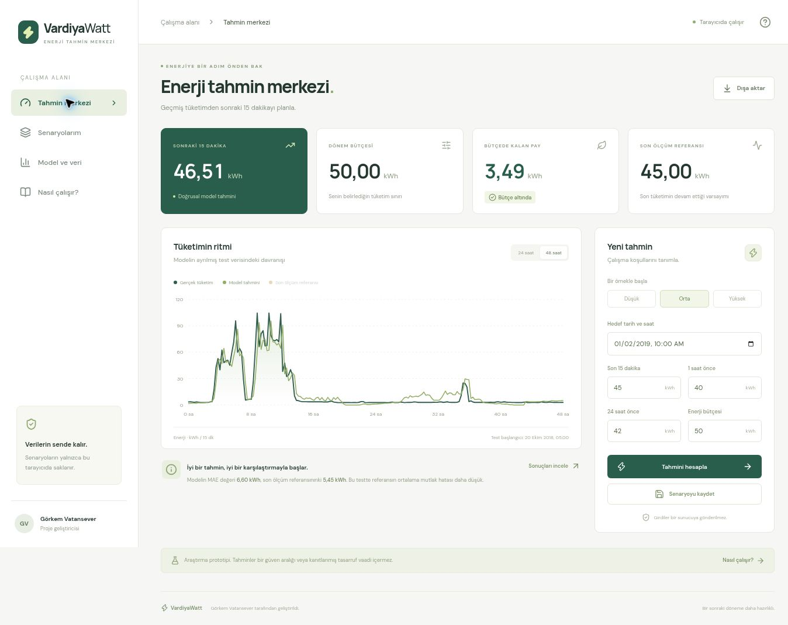
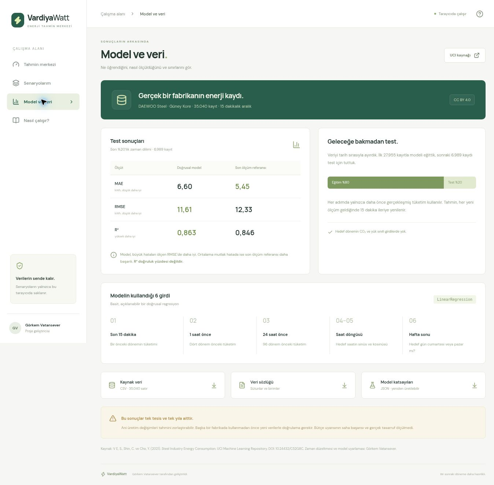

# VardiyaWatt

**Geçmiş tüketimden sonraki 15 dakikanın enerjisini tahmin eden React uygulaması.**

VardiyaWatt, bir işletmenin son ölçümlerini kullanıcı tanımlı enerji bütçesiyle birlikte yorumlar. Python'da eğitilen doğrusal regresyon modelini tarayıcıda çalıştırır. Son ölçüm referansını da göstererek karşılaştırmaya olanak verir. Senaryolar LocalStorage ile cihazda saklanır.



## Özellikler

- 15 dakika, 1 saat ve 24 saat önceki tüketimle bir dönem ileri tahmin.
- Düşük, orta ve yüksek tüketim için üç örnek senaryo.
- Kullanıcının belirlediği dönem bütçesine göre uyarı.
- Senaryoyu adlandırma, kaydetme, arama, filtreleme, yeniden açma ve silme.
- Yenileme sonrasında korunan LocalStorage kayıtları.
- Excel/Sheets uyumlu UTF-8 CSV indirme ve formül enjeksiyonuna karşı serbest metin koruması.
- Gerçek test verisiyle çizilen 24/48 saat grafiği ve açılıp kapanan veri serileri.
- Model sonuçları, veri kaynağı ve sınırlılıklar için ayrı ekran.
- Telefon ve masaüstü için uyarlanan saf CSS tasarımı.

Hesaplamalar istemcide yapılır. Bir OpenAI API anahtarı, ücretli servis, GPU veya uygulama sunucusu gerekmez. Grafik, sabit test verisini gösterir; canlı sayaç bağlantısı değildir.

## Kurulum

Node.js 22.12 veya daha yeni desteklenen bir sürüm ve npm gerekir. Projeyi indirin ya da GitHub deposunu klonlayın, proje klasöründe çalıştırın:

```bash
npm ci
npm run dev
```

Terminalin gösterdiği yerel adresi açın. Üretim çıktısı ve testler:

```bash
npm test
npm run build
npm run preview
```

`npm run build` dağıtıma hazır dosyaları `dist/` içine yazar. Bağımlılık sürümleri `package.json` ve `package-lock.json` içinde sabitlenmiştir.

### IDE

Proje VS Code, Cursor veya WebStorm ile açılabilir. VS Code için `vardiyawatt.code-workspace` dosyasını açın. `.vscode/extensions.json` React/JavaScript ve GitHub Copilot önerilerini içerir. Copilot zorunlu değildir; bu proje ChatGPT/Codex destekli geliştirme ortamında hazırlanmıştır. VS Code'da **Terminal > Run Task** menüsünde geliştirme, test ve derleme görevleri bulunur.

## Kullanım

1. Tahmin merkezinde bir örnek seçin veya geçmiş tüketimlerinizi kWh olarak girin.
2. Hedef zaman son bilinen ölçümden 15 dakika sonra olmalıdır. Dakika 00, 15, 30 veya 45 olmalıdır.
3. Enerji bütçesini girip **Tahmini hesapla** düğmesine basın.
4. **Senaryoyu kaydet** ile bir isim verin. **Senaryolarım** ekranından kayıtları karşılaştırın.
5. CSV indirerek kayıtlarınızı yedekleyin.

Örneklerdeki 50 kWh, 15 dakikalık bir dönem için kullanıcı varsayımıdır. Gerçek işletme limiti değildir. Dönem enerjisi (kWh) ile anlık güç (kW) birbirinden farklıdır. Kayıtlar başka cihaza taşınmaz. Tarayıcı verilerinin temizlenmesi kayıtları siler.

## Teknolojiler

| Alan | Seçim | Kullanım |
|---|---|---|
| Arayüz | React 19.3.1 | Bileşenler, state, olaylar ve formlar |
| Geliştirme/derleme | Vite 8.3.8 | Geliştirme sunucusu ve statik üretim çıktısı |
| Stil | Saf CSS | Grid, Flexbox, responsive görünüm ve odak stilleri |
| İkon | lucide-react 1.73.0 | SVG arayüz ikonları |
| Kalıcılık | LocalStorage | Sürüm 1 senaryo kayıt şeması |
| Grafik | SVG + React | Gerçek test verisinin etkileşimli gösterimi |
| Makine öğrenmesi | Python, Pandas, NumPy, scikit-learn | Eğitim ve katsayı dışa aktarma |
| Test | Node.js yerleşik test çalıştırıcısı | Sayısal uyum, validasyon ve CSV kontrolleri |

Yazı tipleri Google Fonts üzerinden yüklenir. Erişilemezse sistem sans-serif yedeği devreye girer.

## Veri ve yöntem

**Steel Industry Energy Consumption**, UCI veri seti 851, 35.040 satır ve 11 sütundur. Veri DAEWOO Steel'in Güney Kore'deki işletmesinden gelir. CSV `public/data/steel-industry.csv` içinde orijinal haliyle bulunur.

Gece yarısı satırları, satır sırası ve `NSM=0` bilgisine göre izleyen güne taşınır. Böylece kayıt aralığı 1 Ocak 2018 00:15 ile 1 Ocak 2019 00:00 olur. 24 saatlik gecikme için ilk 96 satır çıkarılır. Eğitim 27.955, test 6.989 satırdır. Bölme zaman sıralıdır, veri karıştırılmaz.

Model girdileri:

| Özellik | Anlam |
|---|---|
| `lag_1` | Bir önceki 15 dakikalık dönemin tüketimi |
| `lag_4` | 1 saat önceki dönemin tüketimi |
| `lag_96` | 24 saat önceki dönemin tüketimi |
| `hour_sin` | Hedef saat döngüsünün sinüsü |
| `hour_cos` | Hedef saat döngüsünün kosinüsü |
| `weekend` | Cumartesi/pazar göstergesi |

Hedef `Usage_kWh` değeridir. Aynı dönemin CO₂, reaktif enerji, güç faktörü ve yük sınıfı girdi olarak kullanılmaz. Model `LinearRegression` ile eğitilir; negatif tahminler sıfıra kırpılır. Her test adımı daha önce gerçekleşen ölçümleri kullanır. Bu, aylara yayılan çok adımlı tahmin değildir.

### Test sonuçları

| Yöntem | MAE (kWh) | RMSE (kWh) | R² |
|---|---:|---:|---:|
| Doğrusal regresyon | 6,6038 | 11,6100 | 0,8632 |
| Son ölçüm referansı | 5,4474 | 12,3314 | 0,8457 |

Model RMSE açısından daha iyi, MAE açısından daha kötüdür. MAE öncelikliyse bu testte referans tercih edilir. R² doğruluk yüzdesi değildir. Tek tesis ve tek yıl, farklı işletmelere genelleme kanıtı sağlamaz. Gerçek tasarruf, güven aralığı veya bütçe uyarısının saha başarısı ölçülmedi.



### Modeli yeniden üretme

Web uygulamasını çalıştırmak için Python gerekmez. İsteğe bağlı olarak modeli yeniden eğitmek için:

```bash
python -m pip install -r scripts/requirements.txt
python scripts/export_model.py
npm test
npm run build
```

Eğitim scripti kaynak CSV'den model katsayılarını, metriklerini ve ilk 192 test kaydını yeniden üretir. JavaScript hesaplaması `src/lib/model.mjs` içinde açıklanmıştır. Tam eğitim açıklaması `docs/VardiyaWatt_Colab.ipynb`, kısa rapor `docs/VardiyaWatt_Rapor.pdf` dosyasındadır.

## Ekranlar ve veri modeli

- **Tahmin merkezi:** Girdi, tahmin, bütçe ve test grafiği.
- **Senaryolarım:** Yerel kayıt, arama/filtre ve CSV.
- **Model ve veri:** Sonuç karşılaştırması, veri sözlüğü ve kaynak indirme.
- **Nasıl çalışır:** Kullanım adımları ve sorular.

Kayıt biçimi:

```json
{
  "version": 1,
  "scenarios": [
    {
      "id": "tarayici-tarafindan-uretilen-uuid",
      "name": "Gündüz vardiyası",
      "input": {
        "time": "2019-01-02T10:00",
        "last": 45,
        "hour": 40,
        "day": 42,
        "budget": 50
      }
    }
  ]
}
```

Kimlik `crypto.randomUUID()` ile üretilir. En fazla 50 kayıt saklanır. Saklanan kullanıcı adı gibi serbest metin React tarafından metin olarak gösterilir. CSV'de formül başlangıçları etkisizleştirilir.

## Yapay zeka nerede ve nasıl kullanıldı

Geliştirme asistanı: **ChatGPT / Codex**.

| Aşama | Yapay zeka katkısı | Doğrulama |
|---|---|---|
| Planlama | Fikir, ekranlar ve veri şeması | Proje yönergesinin maddeleriyle eşleştirme |
| Veri/model | Açık veri seçimi, zaman düzeltmesi, regresyon | Gerçek kod çalıştırma ve referans karşılaştırması |
| Bileşenler | Form, grafik, senaryo tablosu | Tarayıcıda etkileşim kontrolü |
| Stil | CSS yerleşimi ve responsive kırılımlar | Masaüstü görünümünün görsel kontrolü |
| Hata ayıklama | CSV, tarih ve girdi doğrulaması | Otomatik testler ve elle hatalı giriş denemesi |
| Dokümantasyon | README, veri açıklaması ve teslim kontrolü | Uygulamanın gerçek davranışıyla karşılaştırma |

Kullanılan görevlerin istem örnekleri ve inceleme notları `docs/AI_KULLANIMI.md` dosyasındadır. Bunlar geliştirme görevlerinin kısa özetleridir, konuşmanın birebir dökümü değildir. Uygulama kullanıcısı bir LLM servisine bağlanmaz; webdeki tahmin, daha önce eğitilmiş regresyon modelinden gelir.

## Yayına alma

Uygulama standart bir statik Vite çıktısı üretir. Bir platforma bağımlı değildir.

| Platform | Derleme | Yayın klasörü |
|---|---|---|
| Netlify | `npm run build` | `dist` |
| Vercel | Vite otomatik ayarı | `dist` |
| GitHub Pages | `.github/workflows/pages.yml` | `dist` |
| ChatGPT Sites | Kaynak sürümü ve statik dağıtım | `dist` |

Netlify için `netlify.toml`, Vercel için `vercel.json`, GitHub Pages için derleme ve yayın iş akışı hazırdır. GitHub Pages kullanırken deponun **Settings > Pages > Source** alanında **GitHub Actions** seçilmelidir. Relative asset yolları alt klasöre yayınlamayı destekler. Yönlendirme hash tabanlıdır, sunucu tarafı rota kuralı gerektirmez.

Public GitHub deposu ve eğitmene açık canlı bağlantı tamamlandıktan sonra teslim alanına iki gerçek URL eklenir. Kişisel erişim belirteçlerini veya parola dosyalarını depoya koymayın. GitHub'a aktarırken `.openai/hosting.json` isteğe bağlıdır; bu dosya yalnız Sites kimliğini içerir.

## Proje yapısı

```text
src/
  App.jsx                    Ekranlar ve senaryo akışı
  components/EnergyChart.jsx  Etkileşimli test grafiği
  lib/model.mjs              Tahmin, doğrulama ve CSV
  data/                      Model ve gerçek test kesiti
  styles.css                 Responsive saf CSS
public/data/                 Kaynak CSV, veri sözlüğü, katsayılar
scripts/export_model.py      Yeniden eğitim ve JSON dışa aktarma
tests/model.test.mjs         Sayısal testler
docs/                       Ekran görüntüleri ve dokümantasyon
```

## Kaynak ve lisans

V E, S., Shin, C., & Cho, Y. (2021). *Steel Industry Energy Consumption* [Dataset]. UCI Machine Learning Repository. https://doi.org/10.24432/C52G8C

Veri lisansı **CC BY 4.0**: https://creativecommons.org/licenses/by/4.0/ . Uyarlamalar: zaman damgası düzeltmesi, geçmiş tüketim özellikleri ve regresyon hedefi. Kaynak CSV değiştirilmedi. Arayüz ve proje uyarlaması: Görkem Vatansever.

Resmi teknik kaynaklar: [React](https://react.dev/learn), [Vite](https://vite.dev/guide/), [GitHub Pages](https://docs.github.com/en/pages/getting-started-with-github-pages/using-custom-workflows-with-github-pages).
